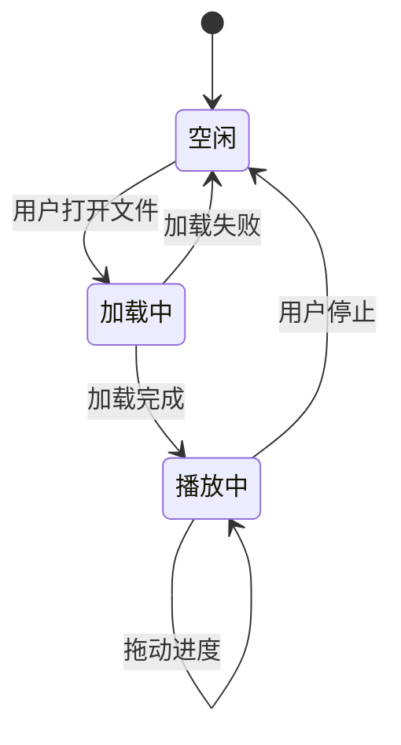

# 状态图

图给读者看。读者决定这个行为对不对，所以图上的词用读者的语言，不用变量名。

只画状态和转移，不检查规则、不标注违规状态。

## 1. 定范围

- 范围是调用方给的功能、协议、模块或代码路径。没给就从当前改动或用户描述里取，并说明你取了什么。
- 确认三件事：起点是什么，读者是谁，哪些状态读者关心。拿不准就写出你的理解再画。

## 2. 列状态

从代码、测试、日志或描述里归纳状态。判据：读者能观察到差别的地方才是一个状态。

- 状态名用读者看得见的词，例如「付款中」「租约已持有」，不用 `phase == 2` 或内部枚举名。
- 一个值如果对读者没有可见差别，不要单独成状态；合并成同一个标签。
- 复合状态只在对读者有意义时用：内部步骤读者关心，才画成父状态带子状态。

## 3. 列转移

每条转移写成一件事，主语是做事的人或外部系统。

- 标签写触发者视角的动作：「用户按下播放」「连接失败」「租约到期」。
- 条件必须影响走向时，在标签末尾用方括号写条件，用读者的词：「用户按下播放 [文件加载中]」。
- 不做「进入状态时顺手做的动作」这类内部细节，除非读者能看到它的结果。

## 4. 控制规模

目标 20 条箭头以内。先合并状态，再考虑隐藏转移。

- 隐藏转移时保持每条规则：每个状态都能从起点走到；有出边的状态至少留一条出边；一条箭头上的转移要么全隐要么全显。
- 隐藏了哪些转移，在交付时用一句话说明。

## 5. 输出

给 Mermaid `stateDiagram-v2` 代码块，必要时配一张渲染图。

语法要点：

- 起始与结束用 `[*]`。
- 一条转移的标签写在冒号后，冒号前是 `源 --> 目标`。
- 复合状态：`state 播放中 { ... }`；并行区域在复合状态里用 `--` 分隔。
- 备注：`note right of 状态: 文字`，只在读者需要解释某个状态时用。
- 状态名含空格或标点时用引号，或先定 `state "显示名" as id`。

## 6. 交付

- 给图和它的 Mermaid 文本，说明模型省略了什么。
- 读者提问后改图，别改代码；要改行为是另一件事。

来源：pstack 的 `statechart` 技能（MIT），已去掉 TLA+ 校验与违规状态标注，只保留绘图。
